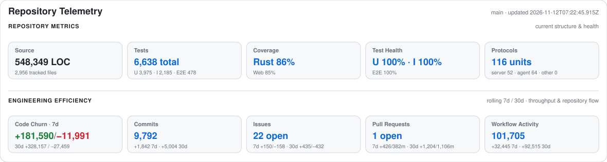
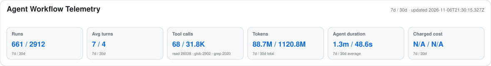

# Nession

[Pages](https://bestnathan.github.io/nession/) · [Vision](VISION.md) · [Principles](PRINCIPLE.md) · [Product](PRODUCT.md)

## Overview

**Nession is an intelligent workspace for continuous work across devices, environments, and compute nodes.** It connects remote machines, persistent terminal Sessions, and the tools surrounding them so users can return to their work without rebuilding the environment each time.

The existing **0.x** product centers on remote terminal control. The **1.x** product is under development, extending that foundation toward a **Session-first, Workspace-centered** experience with contextual capabilities. See [Product](PRODUCT.md) for the product-generation definitions.

## Telemetry

### Repository health

<picture>
  <source media="(prefers-color-scheme: dark)" srcset="https://raw.githubusercontent.com/BestNathan/nession/metrics/repo-metrics-dark.svg?sanitize=true&v=2">
  <source media="(prefers-color-scheme: light)" srcset="https://raw.githubusercontent.com/BestNathan/nession/metrics/repo-metrics-light.svg?sanitize=true&v=2">
  
</picture>

<sub>Published from the <code>metrics</code> branch · <a href="https://raw.githubusercontent.com/BestNathan/nession/metrics/metrics.json">repository metrics (JSON)</a></sub>

### Agent workflow activity

<picture>
  <source media="(prefers-color-scheme: dark)" srcset="https://raw.githubusercontent.com/BestNathan/nession/metrics/agent-metrics-dark.svg?sanitize=true&v=1">
  <source media="(prefers-color-scheme: light)" srcset="https://raw.githubusercontent.com/BestNathan/nession/metrics/agent-metrics-light.svg?sanitize=true&v=1">
  
</picture>

<sub>Observed Agent workflow activity · <a href="https://raw.githubusercontent.com/BestNathan/nession/metrics/agent-metrics.json">Agent workflow metrics (JSON)</a></sub>

## Architecture

Nession's current runtime uses a **Server / Agent / Client** architecture. The Server coordinates identity, discovery and Session metadata; each Agent owns execution on its node and connects to local tmux Sessions. Web and CLI clients attach through the Server relay or directly to an Agent where P2P is available.

```text
                       Web (React / xterm.js)   CLI
                                |                 |
                                +--------+--------+
                                         |
                                   WebSocket
                                         |
                                         v
                              Nession Server
                         (registry / auth / SQLite)
                                         |
                             coordination / relay
                                         |
                                         v
                              Nession Agent(s)
                              (node execution)
                                         |
                                nession-tmux
                                         |
                                         v
                            tmux-backed Sessions

     Web / CLI ---------------- P2P WebSocket ------------> Agent
```

**Connection paths**

- **Relay:** Client → Server → Agent, when the Server is reachable.
- **P2P:** Client → Agent, when a direct endpoint is reachable and authorized.
- **Session execution:** Agent → tmux; client attachment and node connectivity are distinct from Session lifetime.

The longer-term product model introduces logical Workspaces, Workspace Locations and context-aware capabilities around Sessions; this target is described in [Product](PRODUCT.md) and [Product & UI Design](docs/design/README.md), not represented as fully shipped by the diagram above.

## Features

- **Central registry** — agents register on connect and heartbeat; the server persists agents and sessions in SQLite.
- **Web workspace** — React + xterm.js UI for Sessions, terminals and contextual capabilities; the broader Workspace product model is still evolving.
- **Interactive CLI** — list Agents and Sessions, create/kill Sessions and attach to a terminal.
- **Two transports** — relay through the server or P2P directly to the agent.
- **Container-ready** — multi-arch (amd64/arm64) Docker images and Kubernetes manifests (kustomize base + staging/production overlays).
- **Prebuilt binaries** — released for Linux and macOS on every version bump.

---

## Install

### One-line installer (Linux / macOS)

Downloads the release binaries matching your OS and architecture:

```bash
curl -fsSL https://github.com/BestNathan/nession/releases/latest/download/install.sh | sh
```

Options:

```bash
# custom install directory and subset of binaries (add --version for a pinned release)
./scripts/install.sh --dir ~/.local/bin --bins nession

#   -v, --version <ver>   version to install (default: latest)
#   -d, --dir <path>      install dir (default: /usr/local/bin → ~/.local/bin fallback)
#   -b, --bins <list>     comma-separated: nession,nession-agent,nession-server
```

Environment overrides: `NESSION_VERSION`, `NESSION_INSTALL_DIR`, `NESSION_BINS`, and `GITHUB_TOKEN` (to avoid API rate limits).

### From source

Requires **Rust 1.96+** (pinned in `rust-toolchain.toml`) and **Node.js 20+** for the web UI.

```bash
git clone https://github.com/BestNathan/nession.git
cd nession
cargo build --release          # binaries in target/release/
```

Produces three binaries: `nession` (CLI), `nession-agent`, `nession-server`.

---

## Quick start

### 1. Start the server

```bash
nession-server                 # reads ./config.toml if present, else uses the 127.0.0.1:8080 fallback
```

With no `config.toml`, the standalone `nession-server` executable listens on `127.0.0.1:8080` with no auth. The Web development server instead proxies `/ws` and `/api` to port `19090` by default. To use the Web UI locally, configure the Server to listen on `19090` as below (or override `NESSION_DEV_WS_PROXY` in the Web dev environment). Do not expose the no-auth default to untrusted networks.

To customize, create a `config.toml`:

```toml
listen_address = "127.0.0.1:19090"
tls_cert_path = ""             # set both to enable wss://
tls_key_path = ""
auth_token = "your-secret-token"
heartbeat_interval_secs = 10
heartbeat_timeout_secs = 30
# db_path defaults to ~/.nession/server/server.db (or under NESSION_HOME)
```

### 2. Start an agent (needs tmux)

Copy and edit `agent-config.toml`:

```toml
agent_id = "agent-local"
server_url = "ws://127.0.0.1:19090/ws"
auth_token = "your-secret-token"
listen_address = "0.0.0.0:8080"   # internal WS server for P2P
heartbeat_interval_secs = 10
session_poll_interval_secs = 5
# advertise_address / connect_url — optional, for how clients reach this agent (P2P)
```

```bash
nession agent start --config agent-config.toml --foreground
```

The `nession` CLI can also manage the agent/server lifecycle as background processes:

```bash
nession agent start          # background, writes a PID file under ~/.nession/
nession agent status
nession agent stop
nession server start|status|stop
```

`--config` selects the file the daemon loads. An **explicit** `--config` that is
missing or unreadable fails before startup; omitting it uses the target's
documented default (`~/.nession/agent-config.toml` /
`~/.nession/server-config.toml`, or `$NESSION_HOME`). A `server start` with no
config file uses `127.0.0.1:8080`; the standalone `nession-server` binary has
the same no-file fallback. The two daemons' defaults are separate from the
remote CLI target below.

### Configuration files

The same selection is available to the config commands, so `config set` edits
the file a daemon was actually started with:

```bash
nession config agent init --config /srv/nession/agent.toml
nession config agent show --config /srv/nession/agent.toml
nession config agent set --config /srv/nession/agent.toml logging.level debug
nession config server set --config /srv/nession/server.toml terminal_web_font_size 13.5
```

`init`, `show` and `set` without `--config` use the target's default path.
Every serializable `AgentConfig`/`ServerConfig` field is editable with typed
validation; dotted keys address nested values (`logging.level`,
`logging.rotation`, `logging.retention_days`), and `advertise_addresses` takes a
JSON array of URLs. Unknown keys and invalid values are rejected without
writing, and edits preserve comments and unrelated keys. `show` masks
`auth_token`/`agent_token`, and written files are private (0600 on Unix).

A fresh `nession config server init` is deliberately a **local no-auth** file:
`listen_address` is the loopback fallback (`127.0.0.1:8080`) and `auth_token`
is empty. That is safe only for this machine, and it matches what
`nession server start` uses when no config file exists. Accepting clients from
other machines is an explicit opt-in: set a credential and a reachable
listener together.

```bash
nession config server set auth_token <token>
nession config server set listen_address 0.0.0.0:19090
```

`init --force` writes the same safe default again; it never restores an
all-interface listener with a blank token. An operator-authored config is
loaded as written — the CLI does not rewrite it during startup.

### 3. Use it

**CLI** (targets the central Server; override with `--server-url` / `--auth-token`, or set `NESSION_SERVER_URL` / `NESSION_AUTH_TOKEN`). For the `19090` example above, set the target and use the same auth token configured for the Server:

```bash
export NESSION_SERVER_URL=ws://127.0.0.1:19090
# Set NESSION_AUTH_TOKEN to the Server auth token securely in your shell.
nession agents list
nession sessions list [--agent-id <id>]
nession sessions create --agent-id <id> --name dev
nession sessions attach --session-id <agent_id>:<session_name> [--mode p2p|relay]
nession sessions kill   --session-id <agent_id>:<session_name> [--force]
```

`--auth-token` is convenient for a one-off command, but a value passed as a
flag is visible in shell history and in process listings while the command
runs. For repeatable operation, set `NESSION_AUTH_TOKEN` in the environment for
the remote CLI. The daemon config's `auth_token` is a **different credential
direction**: it is the Agent → Server credential (and the Server's inbound
auth), written by `nession config agent set auth_token <token>`. Remote
commands never read a daemon config (#2267) — a config file cannot redefine
where `agents`/`sessions` connect.

Remote commands resolve one target, in this order: the explicit global flag,
`NESSION_SERVER_URL` / `NESSION_AUTH_TOKEN`, the legacy `NENSION_SERVER_URL` /
`NENSION_AUTH_TOKEN` aliases (kept so an existing environment keeps working;
the canonical name wins if both are set), then `ws://127.0.0.1:8080` with an
empty token. Agent and Server daemon configs do not override this CLI target.
A background `nession agent start` never passes its resolved token to the
child process as an argument; the credential goes over a private pipe
instead.

The two global flags apply only where they have an effect. `agents` and
`sessions` read them as the remote target/credential; `agent start` and
`agent restart` read them as overrides for the Agent daemon's outbound target.
`server`, `config`, `update`, and agent stop/status/service commands have no
use for them and **reject** them rather than silently ignoring them:

```bash
# Rejected: --server-url does not configure the Server's listener
nession server start --server-url ws://127.0.0.1:19090
```

**Web UI** — see [Web dashboard](#web-dashboard) below.

---

## Web dashboard

```bash
cd web
npm ci
npm run dev        # Vite dev server :13000, proxies /ws and /api → :19090
```

Open http://localhost:13000, connect to the server, then browse agents and open terminals. For production, `npm run build` emits static assets to `web/dist/` (served by nginx in the Docker/K8s images).

### Terminal presentation and scrollback

The terminal uses a fixed logical column count per Session (96 by default; configurable for a release). Web/App adapt font size and visible rows to each viewport without reflowing the Session into a different column count. See [terminal sizing](docs/design/terminal/terminal-sizing.md) for the current contract.

A Session's history is xterm's own scrollback — the wheel stays in the browser
and never enters tmux copy mode — and attaching (or reloading) fills it from
the Session, so context is available when the terminal mounts. That holds on
the default attach transport; `attach_mode = "plain"` is a fallback, and
[docs/design/terminal/scrollback-bootstrap.md](docs/design/terminal/scrollback-bootstrap.md)
states exactly what it does and does not give you.

---

## Project layout

```
nession/
├── crates/                 # Rust workspace (11 crates; see Cargo.toml)
│   ├── nession-common/     # shared configuration, paths and utilities
│   ├── nession-protocol/   # versioned wire contracts
│   ├── nession-protocol-codegen/ # TypeScript / JSON Schema generation
│   ├── nession-runtime/    # reusable runtime primitives
│   ├── nession-client/     # reusable client library
│   ├── nession-tmux/       # independent typed tmux / Control Mode client
│   ├── nession-server/     # broker, registry, SQLite, WebSocket + TLS
│   ├── nession-agent/      # per-node tmux, server and P2P lifecycle
│   ├── nession-cli/        # interactive CLI and process lifecycle
│   ├── nession-git/        # Git capability / protocol
│   └── nession-claude-code/ # Claude Code capability / protocol
├── web/                    # authenticated React / Vite / xterm.js product UI
├── pages/                  # independent public project observatory
├── docs/                   # architecture, product and design documentation
├── deploy/                 # docker-compose + entrypoints + nginx template
├── design/                 # design tokens + executable UI contracts (`design/generated/` is codegen output)
├── e2e/                    # shared Runner, Cases, Scenarios, Playwright regressions
├── gates/                  # invariant checks and suite catalog
├── scripts/                # tooling, acceptance, metrics, gitops writer, install.sh
├── Dockerfile.*            # server/agent/ui build variants
└── Cargo.toml              # workspace root (version lives here, and in web/package.json)
```

Deployment desired state — the kustomize base, per-environment overlays and the
ArgoCD app-of-apps — lives on the **`gitops` orphan branch**, not on `main`
(issue #592). See "Deploying to Kubernetes" in the root `CLAUDE.md`.

---

## Development

```bash
# Rust
cargo build
cargo test
cargo fmt --all -- --check
cargo clippy -- -D warnings          # must pass with 0 warnings; #[allow(clippy::*)] is forbidden

# Web (in web/)
npm run dev        # dev server :13000
npm run build      # production build → dist/
npm run lint       # ESLint (--max-warnings 0; eslint-disable is forbidden)
npm test           # Vitest
npx tsc --noEmit   # type check
```

See [`AGENTS.md`](AGENTS.md) and the [development Skill](.claude/skills/nession-development/SKILL.md) for current contributor, worktree, Gate and PR rules.

> **Never develop in the root `main` checkout.** Use an isolated worktree and feature branch.

---

## Docker

```bash
# full builds (Rust + UI)
docker build -f Dockerfile.server -t nession-server .
docker build -f Dockerfile.agent  -t nession-agent .
```

Published multi-arch images (on version bumps via CI):

- `ghcr.io/bestnathan/nession:server-<version>`
- `ghcr.io/bestnathan/nession:agent-<version>`
- `ghcr.io/bestnathan/nession:ui-<web-version>`

`deploy/docker-compose.yml` wires server + agent + UI together for local runs.

---

## Kubernetes

The Kubernetes Kustomize base, environment overlays and ArgoCD desired state
are maintained on the [`gitops` branch](https://github.com/BestNathan/nession/tree/gitops),
**not** at `k8s/` in `main` or `staging`. Check out that branch and follow
its current overlay paths before applying manifests.

The deployment nginx listener serves the UI and `/health` endpoint
(container port `10080`), proxying `/ws` to the configured Rust WebSocket
listener. Rust listener ports and external service ports are configuration,
not fixed Kubernetes constants. CI publishes multi-arch images and promotes
versioned image tags through the gitops workflow on version changes
(see the current release workflows under `.github/workflows/`).

---

## Releases

Pushing a version bump (`Cargo.toml` / `web/package.json`) to `main` triggers CI to:

1. Lint + test (Rust and web).
2. Build & push multi-arch Docker images.
3. Build native binaries for Linux (amd64/arm64) and macOS (Intel/Apple Silicon).
4. Publish a GitHub Release `v<version>` with tarballs named `nession-<version>-<os>-<arch>.tar.gz`, each containing `nession`, `nession-agent`, and `nession-server`.

The [installer](#one-line-installer-linux--macos) consumes these release assets.
